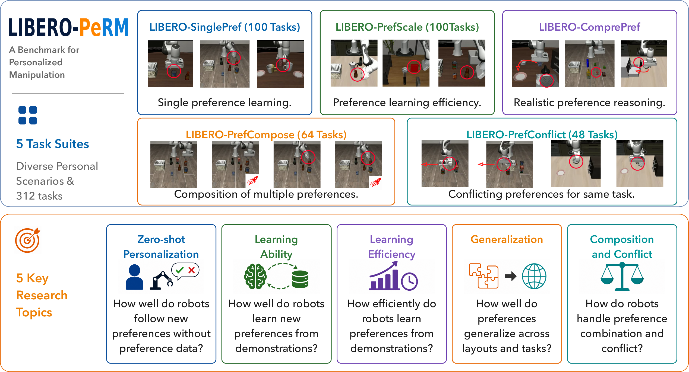

# LIBERO-PeRM: Benchmarking Personalized Robotic Manipulation

[](https://arxiv.org/abs/2610.22372)

[](https://libero-perm.github.io/)


Zhixu Li<sup>1,\*,†</sup>, Keqian Tang<sup>1,\*</sup>, Litian Gong<sup>1,\*</sup>, Jingyu Yao<sup>2</sup>, Wenqian Zhang<sup>1</sup>,
Tianze Xu<sup>5</sup>, Zehao Wang<sup>3</sup>, Yuping Wang<sup>4</sup>, Junge Zhang<sup>3</sup>, Jiachen Li<sup>3,‡</sup>

<sup>1</sup>University of California, Riverside &nbsp; <sup>2</sup>Yale University &nbsp; <sup>3</sup>Georgia Institute of Technology &nbsp;
<sup>4</sup>University of Michigan &nbsp; <sup>5</sup>University of Toronto
<sup>\*</sup>Equal contribution &nbsp; <sup>†</sup>Project lead &nbsp; <sup>‡</sup>Corresponding author

---



**LIBERO-PeRM** is a benchmark for **personalized robotic manipulation**, built on the
[LIBERO](https://github.com/Lifelong-Robot-Learning/LIBERO) framework (MuJoCo + robosuite).
It asks whether a manipulation policy can do a task **the way the user wants it done**: every task comes with a
preference, and a policy is scored on whether it finishes the task (SR) and whether it honors the preference while
doing so (SA). Preferences are treated as controllable variables alongside tasks and layouts: an automated pipeline
generates preference-conditioned demonstrations with per-episode preference-satisfaction metrics at three tiers —
motion, skill and user profile.

NeurIPS 2026, Evaluations & Datasets Track.

## Release checklist

- [x] Paper (arXiv), project page and code
- [ ] LIBERO-SinglePref, LIBERO-PrefScale and LIBERO-ComprePref task suites (by Oct 25, 2026)
- [ ] LIBERO-PrefConflict and LIBERO-PrefCompose task suites (by Nov 1, 2026)
- [ ] Framework for adding new preferences (by Nov 8, 2026)

## The benchmark

Preferences are defined by the part of execution they constrain.

| Level | Constrains | Examples | Instances |
|---|---|---|---|
| Motion | the trajectory | speed up, move higher, keep away from an object | 8 |
| Skill | how one skill is executed | pick from the left side, pick by the handle, push instead of pick-and-place | 14 |
| User profile | which object or target is chosen | prefer red objects, upper drawer for food | 15 |

Five task suites, **312 tasks** in total. A task is one layout, one task instruction and one preference prompt.

| Suite | Tasks | Config key | Probes | Registry |
|---|---|---|---|---|
| LIBERO-SinglePref | 100 | `single-pref` | learning and following one preference, across the three tiers | `LIBERO/dataset/perm_missions.yaml` |
| LIBERO-PrefScale | 100 | `liberoscale` | scaling with demonstrations, tasks and layouts; unseen layouts and tasks | `VLA_data/PrefScale/tasksuite_312.yaml` |
| LIBERO-PrefConflict | 48 | `prefconflict` | preference–preference and task–preference conflicts | `VLA_data/PrefConflict/tasksuite.yaml` |
| LIBERO-PrefCompose | 64 | `pref-compose` | no preference, A, B, and A + B on the same layout and task | `VLA_data/PrefCompose/tasksuite.yaml` |
| LIBERO-ComprePref | reuses tasks | `comprehensive` | rewritten prompts with explicit or implied preferences | `LIBERO/dataset/series_7/language.yaml` |

Config keys are registered in `LIBERO/configs/task_suites.yaml` and selected through the `task_suite` field of a
runfile.

The policy sees one prompt, `Task: {task}. Preference: {preference}.`, and two cameras (third-person and wrist).
Every preference has an explicit metric computed from the rollout: trajectory quantities for motion preferences, the
pose at the grasp or release for skill preferences, the executed subtask for user profiles. Scores are reported as
`SA = mean( success × satisfaction )`, so a failed episode contributes nothing.

## Repository layout

```
LIBERO/            simulator, task definitions and the generation pipeline
  dataset/         one directory per mission: scene (BDDL), plans, preference and metric parameters
  TaskGen/         layouts, instructions, plans
  MotionGen/       heuristic skills and preference-conditioned trajectory generation
  Preference/      preference definitions and satisfaction metrics
  TaskEval/        VLM-based compliance evaluation
  PolicyEval/      rollout client and scoring
  scripts/         calibration, review and rendering tools
VLA_data/          demonstrations per suite and the suite registries
VLA_train/         fine-tuning scripts (openpi)
VLA_infer/         policy servers, rollout client and run profiles
reproduce/         one script per table and figure of the paper
```

## 1. Installation

Requires Ubuntu 22.04, an NVIDIA GPU with driver, and conda.

```bash
git clone https://github.com/tasl-lab/LIBERO-PeRM.git
cd LIBERO-PeRM
conda create -n libero python=3.10 -y && conda activate libero
```

Then install the pinned dependencies (MuJoCo, robosuite, OMPL) and run the EGL rendering check as described in
[INSTALL.md](INSTALL.md). On the first run, LIBERO asks once whether to use a custom dataset folder — answer `N` to
accept the defaults (this writes `~/.libero/config.yaml`). Simulation assets, including the objects added for this
benchmark, ship with the repository under `LIBERO/libero/libero/assets/`.

The generation pipeline and the rollout client share this one environment; each evaluated VLA runs in its own
environment behind a policy server (Section 3).

---

## 2. Data generation & dataset

| Concept | Description |
|---|---|
| **Mission** | One task instance: scene (BDDL) + instruction + plans + preferences, named `X-Y_NNN` (e.g. `2-12_085`) |
| **Layout** | Scene layout for personalized tasks, 1:1 with a BDDL file |
| **TaskPlan** | Sequence of `[skill, object]` steps fulfilling the instruction |
| **Preference** | A constraint the trajectory should satisfy: motion, skill, or user-profile tier |

Modules under `LIBERO/`: `TaskGen` (layouts / plans / preferences), `MotionGen` (heuristic skills + OMPL planner),
`Preference` (preference tiers + satisfaction metrics), `TaskEval` (VLM compliance eval), `PolicyEval` (VLA rollout
driver).

Minimal working example — generate demonstrations for one mission:

```bash
cd LIBERO
bash run_single_mission.sh 2-12_085
```

Runs the heuristic-skill pipeline and writes `Videos/` and `HDF5/` into the mission directory,
`dataset/series_2/perm_2_12/libero_085/`.

Batch generation (mission lists, batch sizes and workers in `batch_run/batch_run.yaml`; details in
`batch_run/batch_run.md`):

```bash
cd LIBERO
bash batch_run.sh                  # dev: quick iteration, saves all videos
bash batch_run.sh --mode data_gen  # training HDF5s, merged per mission into VLA_data/<Suite>/
```

Per-mission logs go to `LIBERO/parallel_logs/<mission_id>.log`.

Dataset layout — one directory per preference series:

```
LIBERO/dataset/
├── series_0/              # no-preference controls
├── series_1/              # motion preferences
├── series_2/              # skill preferences
├── series_3/              # user-profile preferences
├── series_4/              # multi-preference compositions (PrefCompose)
├── series_5/              # PrefScale
├── series_6/              # PrefConflict
├── series_7/              # ComprePref: rewritten prompts (language.yaml)
├── perm_missions.yaml     # mission pairings per preference family
└── libero_missions.yaml   # source LIBERO task registry
```

Each mission lives at `series_<S>/perm_<S>_<Y>/libero_<NNN>/` and holds its `<scene>.bddl` plus a
`mission_info.yaml`:

```yaml
workspace: kitchen_scene4
language_instructions: Put the bowl in the bottom drawer of the cabinet and close it
bddl_file: KITCHEN_SCENE4_put_the_black_bowl_in_the_bottom_drawer_of_the_cabinet_and_close_it.bddl
high_pref_lan: Prefer red objects        # skill or user-profile preference, empty if none
low_pref_lan: ''                         # motion preference, empty if none
naive_plan:                              # plan without the preference: [skill, target]
- [pick_right_edge, akita_black_bowl_1]
- [put_right_edge, white_cabinet_1_cabinet_bottom]
- [close_drawer, white_cabinet_1_cabinet_bottom]
task_plan:                               # plan with the preference
- [pick_right_edge, red_akita_black_bowl_1]
- [put_right_edge, white_cabinet_1_cabinet_bottom]
- [close_drawer, white_cabinet_1_cabinet_bottom]
subtask_offset:                          # per-skill position offsets [x, y, z]
  move_to:_all: [0.0, 0.0, 0.0]          #   _all applies to every instance; skill:object targets one
low_prefs:                               # the metric that scores the preference
- type: plan_choice
  params: {mode: object, pref_objs: [red_akita_black_bowl_1], naive_objs: [akita_black_bowl_1]}
  description: Prefer red objects
low_pref_calibration:                    # anchors measured on paired demonstrations
  plan_choice: {pref_anchor: 1.0, naive_anchor: 0.0, n_pref: 10, n_naive: 10}
```

Preferences are auto-scored per episode at the three tiers (schema in `LIBERO/Preference/README.md`).
Demonstrations are stored as one HDF5 file per mission, `VLA_data/<Suite>/Mission_<mission_id>.hdf5`, with two
camera views, full simulator states, subtask metadata and per-step preference signals;
[VLA_data/README.md](VLA_data/README.md) documents the format. A mission that has a no-preference counterpart ships
both sides, paired on the same initial states.

### One clip per task

`render_task_gallery.py` replays the demonstrations of every task and plots its preference metric over the episode:
rollouts on the left, satisfaction curves on the right. The end of a curve is the episode score.

```bash
cd LIBERO
MUJOCO_GL=egl python scripts/render_task_gallery.py     # writes <suite>/<task>.mp4 and manifest.json
python scripts/review_task_gallery.py                   # collects curves that do not match their condition
```

---

## 3. Policy training & evaluation

Shown for **pi0.5** ([openpi](https://github.com/Physical-Intelligence/openpi)); GR00T, SmolVLA, UniVLA and
OpenVLA-OFT follow the same pattern with their own environments and `VLA_infer/server_<vla>.sh`.

Setup:

```bash
git clone https://github.com/Physical-Intelligence/openpi.git VLAs/openpi
cd VLAs/openpi && GIT_LFS_SKIP_SMUDGE=1 uv sync && cd ../..
bash VLA_train/openpi_overlay/apply_overlay.sh   # custom TrainConfigs, serve.py and norm stats into VLAs/openpi
```

Training — three stages per experiment. `U` is the LIBERO-SinglePref LoRA run of the paper (Table 3); the other
suffixes are listed in [reproduce/README.md](reproduce/README.md):

```bash
bash VLA_train/openpi/runme_gen_finetune_data_U.sh   # 1. HDF5 → LeRobot dataset
bash VLA_train/openpi/runme_cal_stats_U.sh           # 2. compute norm stats
bash VLA_train/openpi/runme_finetune_U.sh            # 3. pi0.5 LoRA finetune
```

Evaluation — one runfile yaml under `VLA_infer/run_profile/` describes one model, one suite and one set of
conditions, and drives both sides. Edit its `server.checkpoint`, then in two terminals:

```bash
cd VLA_infer
bash server_pi05.sh run_profile/ZeroShot/smoke_pi05.yaml   # terminal 1: policy server
bash run_client.sh  run_profile/ZeroShot/smoke_pi05.yaml   # terminal 2: rollout client
```

The client writes SR, per-tier preference rewards, rollout HDF5s and videos into a uniform output tree, with SR and SA
summarized in `evalresult.xlsx`; runfile schema and output layout in `LIBERO/PolicyEval/README.md`.

---

## 4. Reproducing the paper

`reproduce/` chains training and evaluation for each result. `DRY_RUN=1` prints the commands without running them.

```bash
bash reproduce/01_table2_zeroshot.sh                    # Table 2: six VLAs zero-shot on LIBERO-SinglePref
bash reproduce/02_table3_sft.sh {train,eval}            # Table 3: LoRA, Mix-LoRA, Seq-LoRA, ComprePref
bash reproduce/03_fig4_prefscale.sh {train,eval}        # Figure 4: data scaling and L1–L4
bash reproduce/04_table4_prefcompose.sh {train,eval}    # Table 4
bash reproduce/05_table5_prefconflict.sh {train,eval}   # Table 5
```

[reproduce/README.md](reproduce/README.md) lists the setup steps, and `reproduce/manifest.yaml` maps every cell of the
paper to its run profile, training config and checkpoint. These scripts follow the experiments as run for the paper,
which used a 40-mission SinglePref split; the registries above describe the released 312-task benchmark.

## Citation

```bibtex
@inproceedings{li2026liberoperm,
  title     = {LIBERO-PeRM: Benchmarking Personalized Robotic Manipulation},
  author    = {Li, Zhixu and Tang, Keqian and Gong, Litian and Yao, Jingyu and Zhang, Wenqian and
               Xu, Tianze and Wang, Zehao and Wang, Yuping and Zhang, Junge and Li, Jiachen},
  booktitle = {Advances in Neural Information Processing Systems (NeurIPS)},
  year      = {2026}
}
```

## Acknowledgements

LIBERO-PeRM builds on [LIBERO](https://libero-project.github.io/); the code under `LIBERO/` keeps its MIT license
(`LIBERO/LICENSE`).
